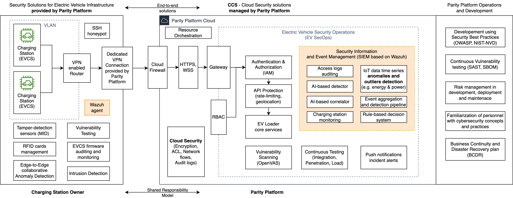

# Resilmesh CCS

Resilmesh CCS is a collection of components for collecting, processing, enriching, and analyzing security events, including telemetry from EV-charging environments. The repository brings together data-pipeline configuration, message-broker and threat-intelligence integrations, Wazuh rules, and a federated-learning anomaly-detection prototype.

## Components

- **Vector** — collects and transforms event data into ECS-compatible events, then routes it through the pipeline. See [Vector/README.md](Vector/README.md).
- **NATS** — message broker used to connect the pipeline and subscriber services. See [NATS/README.md](NATS/README.md).
- **Enrichment** — enriches events using the Silent Push API. See [Enrichment/README.md](Enrichment/README.md).
- **MISP** — forwards enriched events to a MISP instance. See [MISP/README.md](MISP/README.md).
- **Wazuh** — integration rules, decoders, and RSyslog configuration. See [Wazuh/README.md](Wazuh/README.md).
- **Anomaly-Detectors** — federated-learning agent, aggregator, and detection engine. See [Anomaly-Detectors/UMU-T4.3-FL-Anomaly-Detection/README.md](Anomaly-Detectors/UMU-T4.3-FL-Anomaly-Detection/README.md).
- **`docker-compose.yml`** — orchestration configuration for the services and supporting infrastructure.

## Configuration and running

1. Install Docker Engine and the Docker Compose plugin.
2. Review the component-specific READMEs and sample environment files (`.env.example`, `Enrichment/.env.sample`, `MISP/.env.sample`, and `Vector/.env.sample`). Create local environment files as needed and provide your own API keys, passwords, endpoints, and other deployment-specific values. Do not commit populated `.env` files.
3. Review `docker-compose.yml` and the component configuration for your environment before starting services. The compose file references local configuration, certificates, and build contexts; ensure these are present and configured for your deployment.
4. Start and verify the required services using Docker Compose, then follow the component guides to configure integrations and data sources.

The anomaly-detection prototype has its own build and configuration instructions in its README. Its initial datasets are included in that component.

## Security review

A manual review of the current tracked files found **hard-coded demo/default credentials** in `docker-compose.yml` and `setup.sh`, including values used in generated Wazuh configuration and deployment output. Treat these as exposed, replace them with unique secrets before running the stack, and rotate them if they have ever been used in a reachable environment. The compose file also contains default service passwords; do not rely on those defaults for deployment.

The checked sample environment files use placeholders or empty values; no obvious live API token or private-key material was identified in the files inspected. This was a spot check of the current repository contents, **not** a complete scan of all files, Git history, or deployment artifacts, and GitHub secret-scanning alerts could not be queried here. Before treating this repository as clean, run a secret scanner (for example, Gitleaks) over the full history and review GitHub's Secret scanning alerts if enabled. If a real credential was ever committed, revoke/rotate it first; deleting it from the latest commit does not remove it from Git history.

## License

Check the license terms of the individual components and datasets before redistribution or deployment; no repository-wide license was identified during this review.
